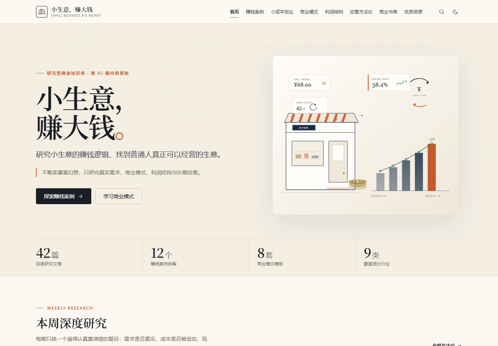
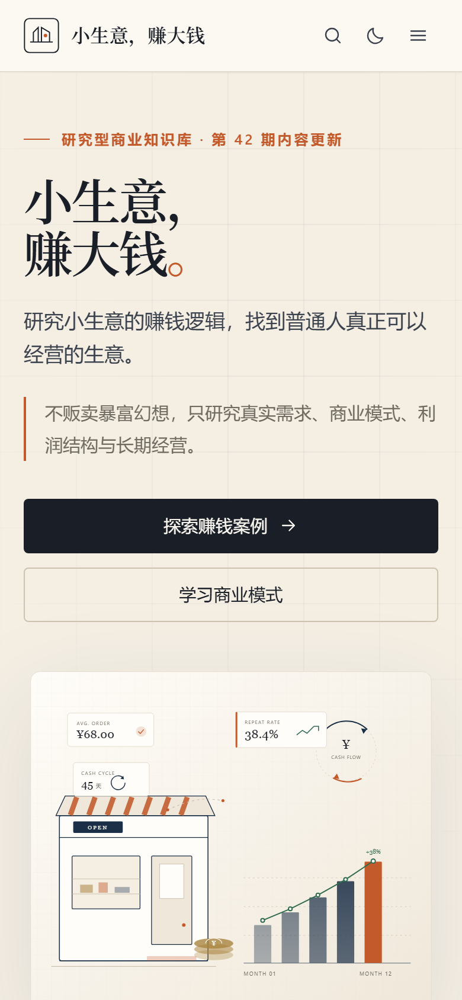
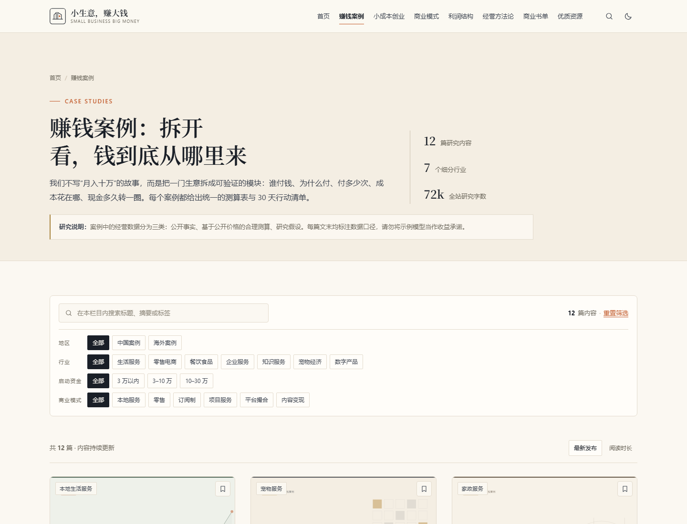
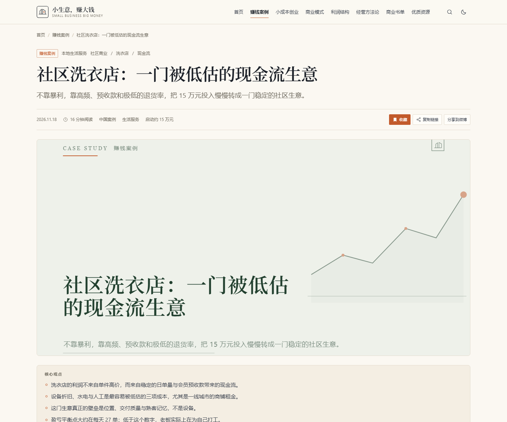
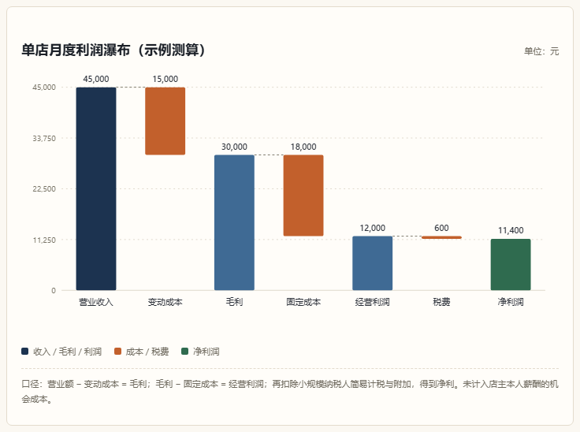
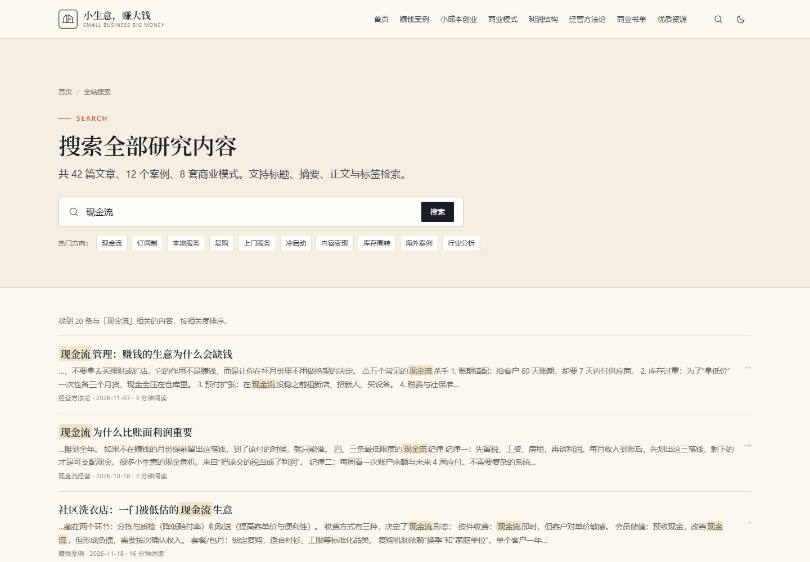
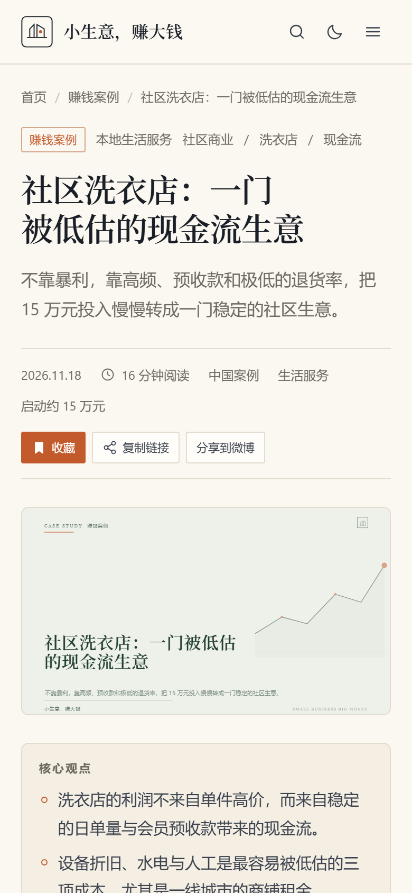

# 小生意，赚大钱 · Small Business Big Money

> 研究小生意的赚钱逻辑，找到普通人真正可以经营的生意。

一个静态部署的中文商业知识库，专注国内外小生意、低成本创业、商业模式、利润结构、现金流与真实赚钱案例。不贩卖暴富幻想，只研究真实需求、成本结构与长期经营。

- 线上形态：纯静态站点，可部署到 GitHub Pages、任意静态托管或自有服务器
- 技术底座：Vite + 原生 JavaScript / CSS + 自研 SSG + Markdown + 原生 SVG
- 内容规模：42 篇研究文章、12 个案例、8 套商业模式、8 篇方法论、12 本书、22 个资源
- 运行时依赖：0（仅构建期使用 Vite）

---

## 一、项目简介

「小生意，赚大钱」不是创业项目黄页，而是一个**研究型知识库**。每篇文章尝试回答同一组问题：

1. 为什么这门生意能够赚钱？
2. 客户为什么愿意付钱？
3. 真实利润从哪里来，成本花在哪？
4. 初始投入多少，固定成本与变动成本如何构成？
5. 第一批客户从哪里来，如何形成复购？
6. 现金流多久转一圈，最坏情况会亏多少？
7. 普通人能不能复制，壁垒与风险是什么？

案例统一采用 A–J 研究模板：案例概况、商业机会、商业模式、成本与利润、获客方法、经营流程、复制可行性、风险与失败原因、30 天行动计划、研究结论。所有经营数字区分**公开事实 / 合理测算 / 研究假设**，并注明计算口径。

## 二、网站定位

| 维度 | 说明 |
| --- | --- |
| 目标读者 | 想用较小资金认真经营一门生意的普通人、个体经营者、小团队 |
| 内容气质 | 商业研究杂志：克制、可验证、可计算、可执行 |
| 不做什么 | 不写「月入十万」故事，不承诺收益，不把个案包装成普遍规律 |
| 差异化 | 统一研究模板 + 成本利润测算 + 原创 SVG 图表 + 失败案例复盘 |
| 商业模式 | 纯内容站点，无付费墙、无广告脚本、无运行时外部 API |

## 三、网站截图

以下截图均由 `scripts/screenshots.js` 驱动本机 Chrome，对**真实构建产物**截图生成，不是设计稿。

### 首页 · 桌面端



### 首页 · 手机端



### 赚钱案例列表与多维筛选



### 案例详情页



### 数据图表（利润瀑布）



### 全站搜索



### 文章 · 手机端



> 另有整页长图 `docs/screenshots/home-full.jpg` 与移动端菜单 `docs/screenshots/home-mobile-menu.png`，可在仓库中查看。

## 四、功能特性

**内容与阅读**

- 8 个 Markdown 内容栏目 + 书单 + 资源 + 搜索 + 关于，共 56 个静态页面
- 文章页：自动目录、阅读进度、核心观点、表格、数据图表、风险提示、30 天行动清单、相关阅读、上一篇/下一篇、返回顶部
- 本地收藏与最近阅读（LocalStorage），不上传任何数据
- 深色 / 浅色主题切换，跟随系统偏好并记忆选择
- 复制链接、系统分享、返回顶部

**检索与筛选**

- 全站搜索：构建期生成索引，支持标题、摘要、正文、标签，按相关度排序并高亮
- 栏目内搜索 + 多维筛选：地区（国内/海外）、行业、启动资金、商业模式、经营难度、主题标签
- 筛选条件与 URL query 双向同步，可分享、可刷新、可后退
- 排序：最新发布 / 阅读时长

**体验与性能**

- PC / 平板 / 手机三档响应式，移动端无横向溢出
- 图片懒加载、尺寸预留、字体系统本地化，避免布局偏移
- 零 UI 框架、零图表库、零运行时 API，首屏只有 HTML/CSS 与约 15 KB 交互脚本
- 404 页面、RSS、manifest、sitemap、robots 均由构建期生成

**明确标注的演示功能**

- Newsletter 订阅表单为**演示模式**：只做邮箱格式校验并提示「尚未接入邮件服务」，不会保存或上传邮箱。页面上有明确说明，不伪装成已实现订阅。

## 五、内容规模（构建期真实统计）

| 内容类型 | 数量 |
| --- | --- |
| 全部研究文章 | 42 篇 |
| 赚钱案例（国内 9 / 海外 3） | 12 个 |
| 商业模式拆解 | 8 套 |
| 经营方法论 | 8 篇 |
| 利润结构 / 现金流 / 创业 / 行业 / 失败 | 3 / 2 / 3 / 3 / 3 篇 |
| 商业书籍 | 12 本 |
| 优质资源 | 22 个 |
| 可见正文（不含图表 JSON 与代码） | 约 7.2 万字 |
| 数据图表类型 | 12 种 |

`npm run check` 会重新统计并校验上述数量，低于门槛即失败。

## 六、技术架构

```text
Markdown (content/)
      │
      ▼
src/content/loader.js ── frontmatter + 自研 Markdown 渲染器
      │                        │
      │                        └── src/render/charts.js（12 种 SVG 图表）
      ▼
src/render/router.js ── 同构渲染函数（Node 构建期 / Vite dev 中间件共用）
      │
      ├── dev：Vite configureServer 按 URL 实时渲染
      └── build：scripts/ssg.js 在 closeBundle 阶段
                 ├── 读取 dist/index.html 提取带 hash 的 CSS/JS
                 ├── 为 55 条路由与 404 页面写入 dist/**/index.html
                 └── 生成 404 / sitemap / robots / RSS / manifest /
                      search-index / .nojekyll
```

关键设计：

1. **同构渲染**：页面是返回 HTML 字符串的纯函数，开发服务器与生产构建走同一套代码，不会出现「dev 正常、build 出错」。
2. **零运行时依赖**：唯一的 devDependency 是 Vite。没有 React、Vue、Tailwind、Chart.js、Lodash。
3. **内容与代码分离**：文章只写在 `content/`，栏目配置在 `src/data/site.js`，书籍与资源是结构化数据。
4. **渐进增强**：所有内容在禁用 JavaScript 时仍可阅读；搜索、筛选、收藏、主题切换是增强层。
5. **构建期完成重活**：目录、阅读时长、图表、相关推荐、SEO 元数据、搜索索引全部在构建时算好，浏览器只做交互。

## 七、项目目录结构

```text
.
├── content/                    # 42 篇 Markdown 研究文章
│   ├── cases/                  # 赚钱案例（12）
│   ├── startup/                # 小成本创业（3）
│   ├── business-models/        # 商业模式（8）
│   ├── profit/                 # 利润结构（3）
│   ├── cash-flow/              # 现金流经营（2）
│   ├── methods/                # 经营方法论（8）
│   ├── industries/             # 行业机会（3）
│   └── failures/               # 失败案例（3）
├── docs/
│   ├── ASSETS.md               # 图片资源清单（来源、尺寸、授权）
│   └── screenshots/            # README 使用的真实网页截图
├── public/
│   └── assets/
│       ├── icons/              # 品牌图标（原创 SVG）
│       └── images/
│           ├── covers/         # 42 张文章封面（原创 SVG）
│           ├── books/          # 12 张书籍封面（原创 SVG）
│           └── og-default.svg  # 社交分享默认图
├── scripts/
│   ├── ssg.js                  # Vite SSG 插件：路由渲染与产物输出
│   ├── generate-images.js      # 生成文章 / 书籍封面 SVG
│   ├── check-site.js           # 内容、图片、产物、SEO 自检
│   └── screenshots.js          # CDP 浏览器验收 + 截图（零依赖）
├── src/
│   ├── content/loader.js       # 内容加载与 frontmatter 解析
│   ├── data/                   # site / books / resources 结构化数据
│   ├── render/                 # layout、router、home、section、article、
│   │                           # books、resources、about、search、
│   │                           # components、charts、hero-art
│   ├── scripts/                # 浏览器交互：ui / article / filters /
│   │                           # search / store / main
│   ├── styles/                 # tokens / main / layout / components / pages
│   ├── utils/                  # seo、outputs
│   └── markdown.js             # 轻量 Markdown 渲染器
├── .github/workflows/deploy.yml
├── index.html                  # Vite 入口（构建期被 SSG 替换为真实页面）
├── vite.config.js
├── package.json
├── LICENSE
└── README.md
```

## 八、本地运行

### 环境要求

- Node.js **20+**（Vite 6 要求 18+；`npm run screenshots` 使用内置 WebSocket，建议 Node 22+）
- npm 10+
- 可选：本机 Chrome 或 Edge（仅截图脚本需要）

### 安装与启动

```bash
npm install
npm run dev          # http://localhost:5173
```

开发模式下，每个 URL 都由同一个渲染器实时生成，修改 Markdown 后刷新即可看到结果。

### 常用命令

| 命令 | 作用 |
| --- | --- |
| `npm run dev` | 启动开发服务器（5173） |
| `npm run build` | 生成 `dist/`，包含 56 个页面与全部静态产物 |
| `npm run preview` | 预览生产构建（4173） |
| `npm run check` | 内容量、字段、封面文件、正文长度、死链、SEO、图片外链自检 |
| `npm run images` | 重新生成 42 张文章封面与 12 张书籍封面 |
| `npm run screenshots` | 启动无头浏览器验收并输出 `docs/screenshots/` |

### 本地构建

```bash
npm run build
npm run preview
```

构建成功后会输出：

```text
dist/index.html
dist/assets/style-<hash>.css
dist/assets/index-<hash>.js
dist/404.html
dist/sitemap.xml
dist/robots.txt
dist/feed.xml
dist/manifest.webmanifest
dist/data/search-index.json
dist/**/index.html          # 每个路由一个可直达的 HTML
```

## 九、GitHub Pages 部署

### 自动化流程

`.github/workflows/deploy.yml` 已配置完整流水线：

1. 推送到 `main` 或手动 `workflow_dispatch` 触发；
2. `actions/setup-node@v4` 安装 Node 20 并缓存 npm；
3. `npm ci` 安装依赖；
4. `actions/configure-pages@v5` 读取 Pages 配置；
5. 根据仓库类型自动计算 base path 与站点地址：
   - `public/CNAME` 存在 → `BASE_PATH=/`，`SITE_URL=https://<自定义域名>`
   - 仓库名为 `<user>.github.io` → `BASE_PATH=/`
   - 其他仓库 → `BASE_PATH=/<repo>/`，`SITE_URL=https://<user>.github.io/<repo>`
6. `npm run build` 构建；
7. `npm run check` 校验内容与产物，任一项失败则终止部署；
8. `actions/upload-pages-artifact@v3` 上传 `dist`；
9. `actions/deploy-pages@v4` 发布到 GitHub Pages。

Workflow 自动把仓库地址注入 `SITE_REPO_URL`，页脚的 GitHub 链接无需手工修改。

### 首次部署步骤

1. 在 GitHub 新建仓库，名称建议 `small-business-big-money`；
2. 推送代码到 `main` 分支：

   ```bash
   git remote add origin https://github.com/<your-name>/small-business-big-money.git
   git push -u origin main
   ```

3. 打开仓库 **Settings → Pages → Build and deployment**，将 **Source** 设为 **GitHub Actions**；
4. 进入 **Actions** 标签，等待 `Deploy to GitHub Pages` 运行完成（也可手动 Run workflow）；
5. 访问 `https://<your-name>.github.io/small-business-big-money/`。

> 首次部署前请确认仓库已启用 Actions。若使用私有仓库，GitHub Pages 的可用性取决于账户套餐。

### 自定义域名

1. 在仓库新增 `public/CNAME`，内容为域名（单行，例如 `smallbiz.example.com`）；
2. 在 **Settings → Pages → Custom domain** 填入同一域名；
3. DNS 配置：子域名添加 `CNAME` 指向 `<your-name>.github.io`；根域名配置 A 记录；
4. 等待 DNS 生效并勾选 **Enforce HTTPS**；
5. 重新运行部署。Workflow 会读取 `CNAME`，自动把 `BASE_PATH` 设为 `/`、`SITE_URL` 设为该域名。

### 子路径与 base path 约定

站点所有内部链接与资源引用都通过 `withBase(base, path)` 生成，canonical / OG / sitemap / RSS 通过 `absoluteUrl(base, path)` 生成。`SITE_URL` 允许已包含子路径（例如 `https://user.github.io/small-business-big-money`），此时不会重复拼接。

手动验证子路径构建：

```bash
# macOS / Linux
BASE_PATH=/small-business-big-money/ \
SITE_URL=https://user.github.io/small-business-big-money \
npm run build && npm run check
```

```powershell
# Windows PowerShell
$env:BASE_PATH="/small-business-big-money/"
$env:SITE_URL="https://user.github.io/small-business-big-money"
npm run build
npm run check
```

构建后可用 `npx vite preview --port 4173` 访问 `http://127.0.0.1:4173/small-business-big-money/` 验证。

## 十、如何添加内容

### 1. 新建文章

在对应栏目目录新建 Markdown 文件，文件名即 URL slug：

```text
content/<section>/<slug>.md
→ https://<site>/<section>/<slug>/
```

`<section>` 取值：`cases`、`startup`、`business-models`、`profit`、`cash-flow`、`methods`、`industries`、`failures`。

### 2. frontmatter 字段

```yaml
---
title: 社区洗衣店：一门被低估的现金流生意
subtitle: 不靠暴利，靠高频、预收款和极低的退货率……
description: 用于 SEO 与列表摘要，建议 60–120 字。
category: 本地生活服务
tags: [社区商业, 洗衣店, 现金流, 预收款]
date: 2026-11-18
readingTime: 16
featured: true
region: cn
industry: 生活服务
model: 本地服务
startupCost: 15
difficulty: 中
payback: 12–18 个月
takeaways:
  - 核心观点一
  - 核心观点二
keyNumbers:
  - 初始投入约 15 万元
  - 月固定成本约 1.8 万元
sources:
  - 国家统计局，https://www.stats.gov.cn/，访问日期 2026-11-18
economics: {"revenue":45000,"variable":15000,"fixed":18000,"tax":600}
cover: /assets/images/covers/community-laundry.svg
---
```

| 字段 | 必填 | 说明 |
| --- | --- | --- |
| `title` | 是 | 文章标题，用于 H1、SEO、封面 |
| `subtitle` | 否 | 副标题，显示在标题下方 |
| `description` | 是 | SEO 描述与列表摘要 |
| `category` | 否 | 栏目内分类，默认取栏目名 |
| `tags` | 是 | 标签数组，用于筛选与相关推荐 |
| `date` | 是 | `YYYY-MM-DD`，用于排序与 sitemap |
| `readingTime` | 否 | 分钟；缺省按中文 380 字/分钟估算 |
| `featured` | 否 | 是否进入首页重点推荐 |
| `region` | 案例必填 | `cn` / `global` |
| `industry` | 建议 | 行业筛选值，需与 `src/data/site.js` 的选项一致 |
| `model` | 建议 | 商业模式筛选值 |
| `startupCost` | 案例必填 | 数字，单位「万元」；不要加引号或单位 |
| `difficulty` | 否 | `低` / `中` / `高` |
| `payback` | 否 | 回本周期描述 |
| `takeaways` | 是 | 核心观点，多行数组 |
| `keyNumbers` | 是 | 关键数字，多行数组 |
| `sources` | 是 | 来源 + 链接 + 访问日期；`npm run check` 会校验非空 |
| `economics` | 否 | 单行 JSON，案例利润模型，供首页与图表使用 |
| `cover` | 否 | 缺省为 `/assets/images/covers/<slug>.svg` |

### 3. 正文语法

- `##` / `###` 自动进入目录（H2、H3），H4 不进入目录；
- 支持列表、表格、引用、代码块、图片、链接、粗体、斜体、行内代码与 `==高亮==`；
- 自定义块：

  ```markdown
  :::note 数据说明
  这里是提示内容，支持 **行内格式**。
  :::

  :::risk
  风险提示。
  :::

  :::action 30 天行动
  可执行清单。
  :::

  :::quote 来源标题
  一段值得单独强调的原话。
  :::
  ```

- 数据图表（JSON 必须在块内首行开始，且使用数字而非字符串）：

  ```markdown
  :::chart profit-waterfall
  {"title":"单店月度利润瀑布","unit":"元","revenue":45000,"variable":15000,"fixed":18000,"tax":600,"note":"口径：……"}
  :::
  ```

### 4. 内容规范

1. 每个案例按 A–J 模板组织，缺项要说明原因；
2. 公开事实必须给出来源与访问日期；测算必须写清假设与公式；
3. 不写「保证赚钱」「稳赚不赔」「月入十万」这类表述；
4. 涉及具体经营者时做匿名化处理；
5. 新增内容后执行 `npm run images`（生成封面）→ `npm run build` → `npm run check`。

## 十一、图片资源管理

- 所有正式图片都存放在 `public/assets/`，构建时复制到 `dist/assets/`，页面不引用任何外部图片 URL；
- 文章封面与书籍封面由 `scripts/generate-images.js` 生成：读取 frontmatter 的标题与栏目，输出 1200×750 / 600×900 的原创 SVG；
- Hero 插画在 `src/render/hero-art.js` 内联输出，图表在 `src/render/charts.js` 构建期输出；
- 每张图片必须有 `alt`；列表卡片使用 `loading="lazy"` 与固定宽高比预留空间；
- 资源来源、尺寸与授权登记在 [`docs/ASSETS.md`](docs/ASSETS.md)；
- `npm run check` 会校验：封面文件是否存在、页面是否出现远程图片、dist 内链是否可达。

新增或替换图片：

```bash
# 修改文章标题后重新生成全部封面
npm run images

# 若手工放置图片，请同步更新 ASSETS.md 并运行检查
npm run check
```

## 十二、SVG 图表开发

`src/render/charts.js` 是一个零依赖的图表渲染器，导出 `renderChart(type, config)` 与 `chartTypes`。所有图表共用 `frame()`：统一输出标题、单位、图例、口径说明与 `aria-label`，`viewBox` 响应式缩放，颜色使用 `--chart-*` CSS 变量自动适配深色主题。

当前支持 12 种：

| 类型 | 主要字段（`data` 内） | 用途 |
| --- | --- | --- |
| `profit-waterfall` | `revenue` `variable` `fixed` `tax` | 利润瀑布 |
| `cost-structure` | `items:[{label,value}]` | 收入与成本结构 |
| `cash-cycle` | `nodes:[{label,value}]` `totalDays` | 现金流循环 |
| `break-even` | `fixedCost` `price` `variableCost` `capacity` | 盈亏平衡 |
| `business-canvas` | `keyPartners` `keyActivities` `keyResources` `valueProps` `customerRelations` `channels` `customerSegments` `costStructure` `revenueStreams`（均为字符串数组） | 商业模式画布 |
| `funnel` | `steps:[{label,value}]` | 客户转化漏斗 |
| `retention-loop` | `rate` `caption` `steps:[{label,note}]` | 复购循环 |
| `supply-chain` | `steps:[{label,note}]` | 供应链流程 |
| `value-chain` | `steps:[{label,margin,active}]` | 商业价值链（`margin` 必须非负） |
| `roadmap-30` | `weeks:[{label,theme,tasks:[…]}]` | 30 天路线图 |
| `unit-economics` | `arpu` `grossMargin` `retentionMonths` `cac` | 单客经济 |
| `revenue-mix` | `items:[{label,value}]` | 收入构成（%） |

所有类型都支持 `title`、`note`、`unit`。

新增一种图表：

1. 在 `charts.js` 写一个接收 `config` 的函数，内部调用 `frame()`；
2. 注册到文件末尾的 `registry`；
3. 在 Markdown 中用 `:::chart <type>` + JSON 调用；
4. 运行 `npm run check`，脚本会捕获 `chart-error`。

## 十三、SEO 配置

- 每页独立 `<title>`、`meta description`、`link rel=canonical`；
- Open Graph 与 Twitter Card 完整输出（`og:type`、`og:image`、`og:locale` 等）；
- 结构化数据：`Organization`、`WebSite`、`Article`、`BreadcrumbList`、`CollectionPage`；
- `sitemap.xml`（55 条 URL）、`robots.txt`、RSS `feed.xml`、`manifest.webmanifest`；
- 语义化 HTML：每页唯一 H1，H2/H3 层级由 Markdown 自动生成；
- 中文搜索引擎与 Google 通用：语言标记 `zh-CN`、日期使用 ISO 格式、URL 使用稳定 slug。

两个关键环境变量：

| 变量 | 作用 | 示例 |
| --- | --- | --- |
| `BASE_PATH` | 站点子路径，注入 Vite `base` 与所有链接 | `/small-business-big-money/` |
| `SITE_URL` | 站点绝对地址，用于 canonical / sitemap / RSS / OG | `https://user.github.io/small-business-big-money` |

说明：默认分享图为原创 SVG。部分社交平台只接受 PNG/JPEG，如需最佳兼容性，可将 `og-default.svg` 导出为 1200×630 PNG，并把 `src/utils/seo.js` 中的默认图片路径改为 PNG。

## 十四、质量检查与验收

```bash
npm run build
npm run check
npm run preview      # 另开终端
npm run screenshots
```

最近一次验收结果：

- `npm run build`：成功，输出 **56 个页面**；
- `npm run check`：**0 error / 0 warning**，校验 42 篇文章、12 个案例、8 套模式、8 篇方法论、12 本书、22 个资源、55 条 sitemap URL；
- 子路径构建：`BASE_PATH=/small-business-big-money/` 下 canonical、OG、sitemap、robots、内链全部正确；
- 浏览器验收：**20/20 通过**，覆盖桌面/手机无横向溢出、主题切换、移动菜单、案例筛选与 URL 同步、文章目录/图表/收藏/阅读进度、全站搜索、站内链接可达、控制台无错误、无失败请求；
- README 截图：9 张真实截图保存在 `docs/screenshots/`，README 中嵌入 7 张；

`check-site.js` 主要检查项：

1. 内容数量门槛与 frontmatter 必填字段；
2. 案例 `startupCost` 必须是数字，封面文件必须存在；
3. 正文长度、目录、图表渲染错误、图表 JSON 泄漏；
4. dist 每个页面的 title / description / canonical；
5. 远程图片、本地死链、sitemap / robots / 404 / search-index；
6. 搜索索引中的占位符注入。

## 十五、贡献指南

1. Fork 仓库并从 `main` 创建分支：`git checkout -b content/your-topic`；
2. 新增或修改 `content/` 下的 Markdown，遵循 A–J 模板与来源规范；
3. 本地执行 `npm run images`（如新增文章）、`npm run build`、`npm run check`；
4. 涉及 UI 或交互的改动，请附上桌面与手机截图（可用 `npm run screenshots`）；
5. 提交 PR，说明：改了什么、依据是什么、如何验证。

内容红线：

- 不伪造来源、数据、案例与企业经营数字；
- 不把估算写成事实，不承诺收益；
- 不复制受版权保护的图文，引用需注明出处；
- 不引入运行时外部 API 或追踪脚本。

## 十六、许可证

- 代码、站点模板、原创 SVG 插画与图表：**MIT**，见 [`LICENSE`](LICENSE)；
- 文章正文：**CC BY-NC-SA 4.0**，非商业转载请注明出处并以相同方式共享；商业使用需获得授权；
- 文中引用的外部资料版权归原作者所有。

## 免责声明

本站内容为商业研究与知识分享，不构成投资、财务或法律建议。文中测算均为示例模型，不构成收益承诺。任何生意都存在失败风险，请结合自身资金、能力与本地市场独立判断。